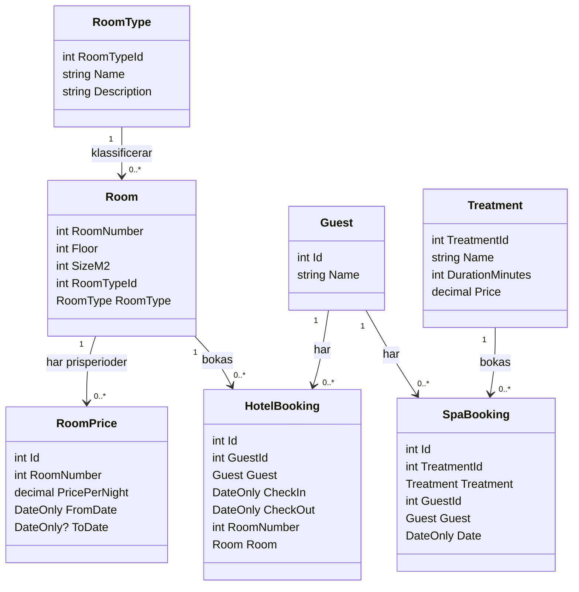

# Hotel Grandioso

Ett konsolbaserat bokningssystem byggt med C#, EF Core och SQLite.

## Funktioner

- Boka och avboka hotellrum.
- Visa bokningar för ett datumintervall.
- Visa tillgängliga rum med rumstyp, storlek och nattpris.
- Beräkna totalpris utifrån antal nätter och nattpris.
- Boka spabehandlingar.
- Ändra rumspriser med giltighetsperioder.

## Köra projektet

### Förutsättningar

- .NET 10 SDK
- EF Core CLI (`dotnet-ef`) version 10

Om EF-verktyget saknas:

```bash
dotnet tool install --global dotnet-ef --version "10.*"
```

Öppna terminalen i projektmappen `HotelGrandioso`, där
`HotelGrandioso.csproj` finns.

Kör:

```bash
dotnet restore
dotnet ef database update
dotnet run
```

Projektet använder följande anslutningssträng i `appsettings.json`:

```json
{
  "ConnectionStrings": {
    "Default": "Data Source=hotel.db"
  }
}
```

Konfigurationsfilen kopieras till programmets körningsmapp vid bygge.
SQLite-filen `hotel.db` använder en relativ sökväg och hamnar i
programmets aktuella arbetsmapp.

### Startdata

Rum, rumstyper, priser och behandlingar har under utvecklingen lagts
in manuellt i SQLite-databasen. Migrationerna skapar tabellerna, men
lägger inte automatiskt in dessa uppgifter.

**Inför inlämningen behöver startdata göras tillgängliga och detta
avsnitt uppdateras med hur de laddas in.**

## Kodstruktur och ansvar

### UI

`Meny` hanterar användarens menyval och inmatning.
Återanvändbara metoder används för att läsa tal, datum och datumintervall.

`RoomView` presenterar rum, bokningar och behandlingar i konsolen.
Rummen grupperas efter våning.

### Services

`HotelBookingService` hanterar rumsbokningar, avbokningar,
tillgänglighetskontroll och prisändringar.

`SpaBookingService` hämtar behandlingar och sparar spabokningar.

Databasanropen ligger i serviceklasserna och använder LINQ och
EF Core. Menyn behöver därför inte känna till hur data hämtas
eller sparas. I detta projekt har jag valt att inte lägga till
ett separat repositorylager.

### Data

`HotelContext` ärver från EF Cores `DbContext`. Klassen ger tillgång
till tabellerna genom `DbSet`, konfigurerar SQLite och beskriver
entiteternas nycklar och relationer.

`HotelContextFactory` används av EF-verktygen när exempelvis
migrationer skapas.

### Models

Modellerna beskriver rum, gäster, bokningar, rumstyper, priser och
spabehandlingar.

`RoomOverview` och `BookingsOverview` är resultatklasser för
information som ska visas i UI. De är inte egna databastabeller.

## Datum och tillgänglighet

En vistelse omfattar ankomstdagen fram till avresedagen.
En ny gäst kan därför checka in samma dag som en annan checkar ut.

En befintlig bokning överlappar önskade datum om:

```text
Befintlig incheckning < önskad utcheckning
OCH
Befintlig utcheckning > önskad incheckning
```

Tillgänglighetsfrågan använder `Any` för att kontrollera om det
finns en överlappande bokning för rummet. Med `!Any` väljs endast
rum utan en sådan bokning.

Service kontrollerar tillgängligheten igen innan bokningen sparas.
Det skyddar även om någon anropar bokningsmetoden utan att först
hämta listan med lediga rum.

Kontrollen och sparandet har ännu inget gemensamt skydd för
samtidiga bokningsförsök från flera programinstanser.

## Prissättning

Priser lagras i `RoomPrice` för att kunna ha olika giltighetsperioder.

- `FromDate` är inkluderande.
- `ToDate` är exkluderande.
- Ett tomt `ToDate` betyder att priset gäller tills vidare.

Prisändringar gäller från dagens datum. Om prisraden redan börjar
idag uppdateras beloppet. Annars avslutas den gamla perioden och
en ny prisrad skapas.

Rumslistan visar dagens giltiga pris. Totalpriset beräknas som:

```text
Antal nätter × nattpris
```

Antalet nätter beräknas som skillnaden mellan utcheckningsdatumets
och incheckningsdatumets `DayNumber`.

I nuvarande version används dagens nattpris för hela vistelsen.
Beräkningen delar inte upp vistelsen mellan olika prisperioder.

## UML-klassdiagram



## Entitetsrelationer

- En rumstyp kan användas av flera rum.
- Ett rum kan ha flera prisperioder och flera bokningar.
- Varje hotellbokning tillhör en gäst och ett rum.
- En gäst kan ha flera hotellbokningar och spabokningar.
- Varje spabokning tillhör en gäst och en behandling.
- En behandling kan förekomma i flera spabokningar.

Vid avbokning tas hotellbokningen bort. Gästen finns kvar.

## GDPR

Jag har granskat hotellchefens önskade gästfält och valt att
bara lagra `Id` och `Name`. Jag vill begränsa uppgifterna till
sådant som behövs för bokningssystemets funktion.

| Fält | Val och motivering |
|---|---|
| Id | Behålls som intern identifierare och för att koppla gästen till bokningar. Namn är inte unika. |
| Name | Behålls för att receptionen ska kunna identifiera och hantera bokningen. |
| HairColor | Utelämnas eftersom hårfärg inte behövs för att boka rum eller behandlingar. |
| HeightCm | Utelämnas eftersom längd inte behövs för systemets funktioner. |
| Religion | Utelämnas eftersom uppgiften inte behövs och är en känslig personuppgift. |

Ett internt ID gör inte gästen anonym, eftersom det är kopplat
till namn och bokningar.

I ett system för verklig drift skulle det även behövas rutiner
för åtkomst, gallring och hantering av personuppgifter.
Den här skolversionen har ingen automatisk gallring.

## Begränsningar

- Spabokningar har datum men inget klockslag eller kapacitetsskydd.
- En ny gästpost skapas vid varje bokning; befintliga gäster återanvänds inte.
- Bokningens pris sparas inte som ett separat historiskt bokningsbelopp.
- Tillgänglighetskontrollen behöver förstärkas för samtidiga bokningsförsök.